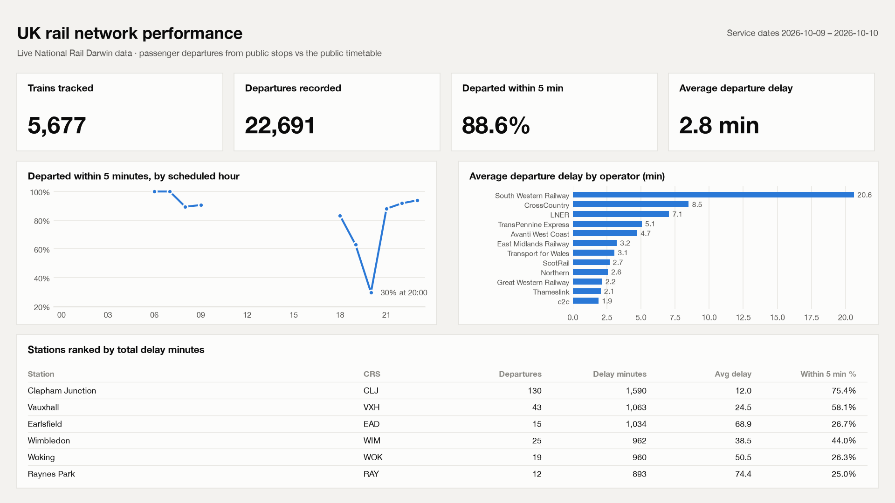
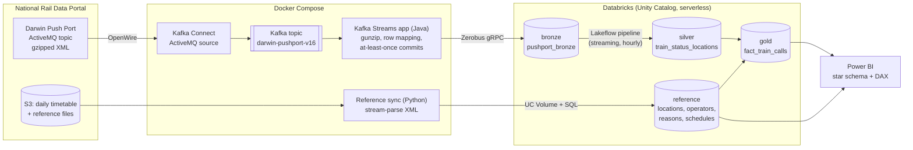

# Darwin Lakehouse: real-time UK rail data platform

[](https://github.com/OWNER/darwin-lakehouse/actions/workflows/ci.yml)


A streaming data platform built on **National Rail's Darwin feed**, the live system behind
every UK departure board. It ingests about 15–30 train-running updates per second and lands them in a
**Databricks lakehouse** as bronze, silver and gold Delta tables. It decodes them with Darwin's
daily timetable and reference data, then models them for **Power BI** as a star schema with DAX
measures.



<sub>Preview rendered from live gold-layer data by [`powerbi/render_preview.py`](powerbi/render_preview.py); the Power BI report in [`powerbi/`](powerbi/) has the same layout. More: [delay causes page](docs/images/dashboard-causes.png).</sub>

## Architecture



| Layer | Table | Grain | How it's built |
|---|---|---|---|
| Bronze | `pushport_bronze` | one Darwin message | Kafka Streams → [Zerobus](https://github.com/databricks/zerobus-sdk) direct write; decompressed XML + JMS metadata |
| Silver | `train_status_locations` | message × train × location | Lakeflow streaming table: XSD-driven `from_xml`, watermark dedupe |
| Gold | `fact_train_calls` | train call (train × location × scheduled time) | Lakeflow materialized view: latest actual/estimated per field, delay minutes |
| Reference | `locations`, `operators`, `late_reasons`, `schedules`, `schedule_locations`, … | per code / per journey | Daily S3 files, stream-parsed in Python, loaded via Volume + `read_files` |
| Serving | `train_status_decoded` (view) | as silver | Silver joined to every lookup: readable names, reasons, delays |

## Engineering highlights

- **At-least-once delivery from Kafka into Delta.** Kafka Streams' interval commits are turned
  off. A wall-clock punctuator waits for Zerobus to acknowledge every queued row and only then
  commits offsets ([`DarwinRowProcessor`](streams/src/main/java/uk/darwin/zerobus/DarwinRowProcessor.java)).
  My first design hooked into state-store flushes. Testing showed those run *after* the offset
  commit, so a crash could have lost rows, and I replaced it before relying on it.
- **Order-preserving XML parsing.** A journey's calling points are differently named elements
  (`OR`, `IP`, `PP`, `DT`, …) whose *order is the route*. Spark's XML reader groups elements by
  name, so the timetable (about 1M calling points a day) is stream-parsed with `iterparse`
  instead, in constant memory ([`parser.py`](src/darwin_lakehouse/reference/parser.py)).
- **Schema-driven silver parsing.** An explicit schema mirrors Darwin's XSDs, and parsing runs
  in `FAILFAST` mode, so malformed messages fail the pipeline instead of silently becoming NULLs.
  Namespace prefixes (`ns5:`) are stripped first because Darwin doesn't guarantee their numbering.
- **Delta semantics handled properly.** TS messages only carry *changed* fields. The gold layer
  rebuilds each call's state with `max_by(field, IF(field IS NULL, NULL, sequence_number))`,
  taking the latest non-null value per field, and computes midnight-safe delays.
- **Validated without the tools.** The Power BI project was built without Power BI available.
  The TMDL model was loaded with Microsoft's Tabular Object Model in a .NET container, and the
  report JSON was checked against Microsoft's published schemas and cross-referenced against the
  model's fields ([`validate_pbir.py`](powerbi/validate_pbir.py), run in CI).
- **One source of secrets.** A single git-ignored `.env` is mounted read-only into every
  container. Kafka Connect reads it through its `FileConfigProvider`, and setup writes generated
  credentials back to it.

More detail and the problems I hit along the way: [docs/design-decisions.md](docs/design-decisions.md).

## Tech stack

| | |
|---|---|
| Ingestion | Apache Kafka (KRaft), Kafka Connect + Confluent ActiveMQ source, Kafka Streams 3.9 (Java 21) |
| Lakehouse | Databricks Unity Catalog, Delta Lake, Lakeflow declarative pipelines (PySpark), Zerobus Ingest, serverless SQL |
| Python | `darwin_lakehouse` package: reference sync (boto3, iterparse), Databricks REST client, workspace setup/deploy CLIs, STOMP feed monitor |
| BI | Power BI Project (PBIP): TMDL semantic model, PBIR report generated from code |
| Quality | pytest, ruff, GitHub Actions (Python, Maven, Power BI schema validation) |

## Repository layout

```
src/darwin_lakehouse/      Python package (CLIs: darwin-setup, darwin-deploy-pipeline,
                           darwin-reference-sync, darwin-feed-monitor)
pipelines/                 Lakeflow pipeline: silver + gold (runs in Databricks)
streams/                   Kafka Streams -> Zerobus app (Java)
infra/                     docker-compose stack, connector config, reference-sync image
powerbi/                   PBIP project, report generator, schema validator, preview renderer
schemas/ppv16/             Darwin Push Port v16 XSDs
tests/                     unit tests + Darwin XML fixtures
docs/                      design decisions, images
```

## Running it

**You need:**
- a free [National Rail Data Portal](https://opendata.nationalrail.co.uk/) account subscribed to Darwin
- a Databricks workspace (Free Edition works) and a personal access token
- Docker and Python 3.11+

```bash
cp .env.example .env            # fill in Darwin + Databricks credentials
python -m venv .venv && source .venv/bin/activate
make install                    # package + dev tools

make setup                      # schema, bronze table, service principal, Zerobus endpoint -> .env
make up                         # Kafka, Connect, Kafka UI (localhost:8080), Streams app, reference sync
make connectors                 # register the Darwin source connector (first run only)
make sync                       # load today's timetable + reference data
make deploy                     # deploy silver/gold pipeline + hourly job, run once
make status                     # connector state and consumer lag
```

Then open `powerbi/DarwinRail.pbip` in Power BI Desktop. See [powerbi/README.md](powerbi/README.md).

## Testing

```bash
make check                          # ruff + pytest
python powerbi/validate_pbir.py     # Power BI files vs Microsoft schemas + model fields
```

## Limitations and next steps

- **Short-notice trains.** Silver covers Train Status (`TS`) messages, which are 94% of the feed.
  Schedule updates (`SC`) are in bronze but not yet parsed, so about 0.3% of trains (short-notice
  services) have no timetable match.
- **Gold refresh cost.** Gold is a full-recompute materialized view over 30 days. At larger
  scale, I'd switch it to an incremental `AUTO CDC` flow keyed by call.
- **Free Edition limits.** Databricks Free Edition allows limited concurrent serverless compute,
  so a pipeline run can collide with the SQL warehouse; the job retries automatically.
- **Portal shutdown.** NRDP shuts down in 2026 in favour of the Rail Data Marketplace; connection
  details are configuration only.

## Credits and licence

- **Data:** Darwin data is provided by National Rail Enquiries via the
  [National Rail Data Portal](https://opendata.nationalrail.co.uk/) under its terms of use.
- **Code:** the STOMP feed monitor derives from OpenTrainTimes Ltd's
  [National Rail Open Data client demonstrator](https://github.com/openraildata/stomp-client-python)
  (GPL-3.0), so this project is released under the [GNU GPL v3](LICENSE).
- **Third-party connectors:** the Confluent ActiveMQ connector is downloaded at runtime and
  remains under Confluent's licence.
